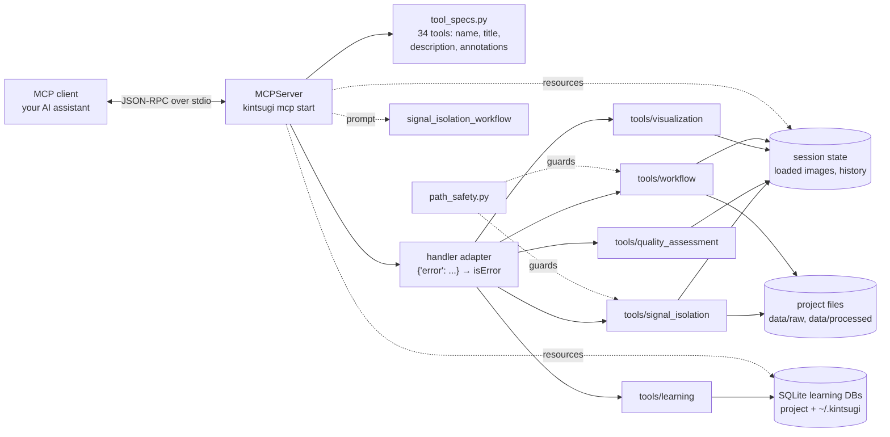

# MCP Server

KINTSUGI ships an optional [Model Context Protocol](https://modelcontextprotocol.io)
(MCP) server that turns the signal-isolation toolbox into tools an AI assistant can
drive. Connect the MCP client you use (see [Connect your client](#connect-your-client))
to a KINTSUGI project, and the assistant can load channels, inspect them, suggest
and apply autofluorescence subtraction, score the result, save it, and record what
worked so the next session starts from it. KINTSUGI itself (CLI, notebooks,
Snakemake workflow) does not need the server or any assistant.

```{contents}
:local:
:depth: 2
```

## What is different about this server

- **Declarative, dependency-free registry.** `kintsugi.mcp.tool_specs.TOOL_SPECS`
  lists every tool (name, handler, title, description, behaviour annotations)
  without importing the SDK, so `kintsugi mcp tools`, the docs generator and
  the tests work without the optional `mcp` extra.
- **Schemas derived from the handlers and enforced.** Parameter descriptions,
  enums and numeric ranges live in the handler signatures
  (`Annotated[int, Field(description=..., ge=1, le=99)]`, `Literal[...]`). The
  SDK advertises them and rejects violations before the handler runs; there is
  no second, hand-written copy that can drift.
- **Structured output on every tool.** Results arrive as `structuredContent`
  (machine-readable) plus a text block, and the tools the model reasons over
  most (`get_image_stats`, `assess_quality`, `suggest_with_learning`,
  `get_session_state`) declare typed output schemas.
- **Path safety as a design rule.** Every path the model supplies is confined
  to the project (`ensure_within` follows symlinks), filenames must be bare
  names, numeric clamps reject NaN/inf/bool, and model checkpoints are only
  loaded from directories the user controls. See [Security model](#security-model).
- **A learning loop.** Parameters the user approves are stored in SQLite
  (project and user-wide), normalised by tissue and marker aliases, and
  recommended back with a confidence that combines match quality, outcome,
  recency and consistency. `kintsugi mcp pretrain` bootstraps the database
  from existing processed data.
- **Tiered automation.** Heuristic suggestion → learned recall → Random Forest
  prediction → Optuna search → parameter-free SMO background estimation, all as
  tools, so the assistant can escalate when the cheap option is not enough.
- **Evaluated, not assumed.** `evals/mcp/harness.py` measures the tool surface
  (token cost, descriptions, titles, annotations, task coverage) and a strict
  structural gate runs in CI; an optional agentic pass measures whether a model
  picks the right tool for realistic requests, through the Anthropic Messages API
  or any OpenAI-compatible endpoint (including local models).

## Sixty-second setup

```bash
pip install -e ".[mcp]"        # or: kintsugi install mcp  (needs mcp>=2.0)
kintsugi mcp clients                                     # the clients it can configure
kintsugi mcp config /path/to/project --client NAME       # configure yours (repeatable)
kintsugi init /path/to/project --mcp-client NAME         # or while creating a project
```

The MCP server is optional, and no client is configured unless you choose it.
`kintsugi mcp config` without `--client` asks which client(s) in a terminal and
otherwise fails with the list; `kintsugi init` without `--mcp-client` asks
(default: none) in a terminal and otherwise creates the project with no MCP
configuration, and `kintsugi init --force` refreshes only the clients the project
already has. `--client all` configures every client below, `--print-only` shows the
configuration without writing, and `kintsugi mcp clients` lists the registry. A
client that keeps its configuration in the project gets that file and an
`AGENTS.md` for the assistant; a client configured per user or in the IDE gets the
entry to paste. [Connect your client](#connect-your-client) lists every client and
what to do after configuring it.

Existing files are merged (other servers and settings are kept; an existing
`kintsugi` entry is replaced only with `--force`), nothing is written outside the
project, and the generated files are added to the project's `.gitignore` because
they hold machine-specific absolute paths: collaborators run `kintsugi mcp config`
on their own machine. `AGENTS.md` is created only when absent; an existing one only
has its generated tool list refreshed. `kintsugi mcp config` refuses a directory without
`kintsugi_project.json` (the server would refuse it as `--project-dir`).

Every client gets the same server entry in its own format. For example,
`--client claude-code` writes these two files:

```json
// .mcp.json — the server definition Claude Code reads
{
  "mcpServers": {
    "kintsugi": {
      "type": "stdio",
      "command": "/path/to/env/bin/kintsugi",
      "args": ["mcp", "start", "--project-dir", "/path/to/project"]
    }
  }
}
```

```json
// .claude/settings.local.json — approves exactly this server
{ "enabledMcpjsonServers": ["kintsugi"] }
```

`command` is the absolute path of the `kintsugi` executable in the environment
you ran the command from, so the client can start the server even when that
environment's `bin/` is not on `PATH`. `--project-dir` tells the server which
project `project_path` defaults to. MCP clients differ in the working directory
and environment they give a server (several ignore a `cwd` field, and some pass
on almost no environment variables), so the project travels in `args`, which
every client supports. Where a client can set environment variables,
`KINTSUGI_PROJECT_DIR` does the same; without either, the working directory is
used only if it contains `kintsugi_project.json`, and tools that need a project
otherwise ask for `project_path` instead of guessing. The server speaks JSON-RPC over stdio; nothing else is written to
stdout (diagnostics go to stderr), and a test spawns the real server over a
pipe to keep it that way.

## Connect your client

`kintsugi mcp config <project> --client NAME` (or `kintsugi init --mcp-client NAME`)
writes or prints the configuration; then follow the last column. The table is
generated from the registry the command uses:

<!-- mcp-tools:clients:begin -->
| Client | `--client` | Configuration | After configuring | Client docs |
|--------|------------|---------------|-------------------|-------------|
| Claude Code | `claude-code` | `.mcp.json` (written) | Open the project folder, accept the trust dialog, then run /mcp. | [docs](https://code.claude.com/docs/en/mcp) |
| VS Code (GitHub Copilot) | `vscode` | `.vscode/mcp.json` (written) | Open the folder, trust the workspace, and start 'kintsugi' from MCP: List Servers. | [docs](https://code.visualstudio.com/docs/copilot/customization/mcp-servers) |
| Cursor | `cursor` | `.cursor/mcp.json` (written) | Open the folder; enable 'kintsugi' under Settings > MCP if prompted. | [docs](https://cursor.com/docs/context/mcp) |
| Gemini CLI | `gemini-cli` | `.gemini/settings.json` (written) | Run 'gemini' in the project folder (trust it with 'gemini trust' if asked), then /mcp. | [docs](https://geminicli.com/docs/tools/mcp-server/) |
| Antigravity | `antigravity` | `.agents/mcp_config.json` (written) | Open the folder as the workspace; the server appears under MCP servers. | [docs](https://antigravity.google/docs/mcp) |
| OpenAI Codex CLI | `codex` | `.codex/config.toml` (written) | Mark the project trusted (Codex loads .codex/config.toml only in trusted projects), then run 'codex' there and /mcp. | [docs](https://developers.openai.com/codex/mcp) |
| Zed | `zed` | `.zed/settings.json` (written) | Open the folder (trust the worktree); the server is listed in the Agent Panel settings. | [docs](https://zed.dev/docs/ai/mcp) |
| Claude Desktop | `claude-desktop` | snippet to paste: claude_desktop_config.json (macOS: ~/Library/Application Support/Claude/; Windows: %APPDATA%\Claude\) | Merge the entry into mcpServers and restart Claude Desktop. | [docs](https://modelcontextprotocol.io/docs/develop/connect-local-servers) |
| Windsurf / Devin Desktop | `windsurf` | snippet to paste: mcp_config.json (~/.config/devin/ or ~/.codeium/; Windows: %APPDATA%\devin\) | Merge the entry into mcpServers, then refresh the MCP servers list. | [docs](https://docs.windsurf.com/windsurf/cascade/mcp) |
| Cline | `cline` | snippet to paste: cline_mcp_settings.json (open it from Cline > MCP Servers > Configure) | Merge the entry into mcpServers and save; Cline restarts the server. | [docs](https://docs.cline.bot/mcp/configuring-mcp-servers) |
| JetBrains AI Assistant | `jetbrains` | snippet to paste: Settings > Tools > AI Assistant > Model Context Protocol (MCP) > Add | Choose STDIO, paste the JSON, and set the working directory to the project folder. | [docs](https://www.jetbrains.com/help/ai-assistant/mcp.html) |

11 clients. Generated from `kintsugi.mcp.clients` by `kintsugi mcp tools --write`; do not edit by hand.
<!-- mcp-tools:clients:end -->

Instructions file: every client above except Claude Desktop reads `AGENTS.md`
(Gemini CLI through the `context.fileName` entry `kintsugi mcp config` adds;
Claude Code reads `CLAUDE.md` first, which can be the single line `@AGENTS.md`).
Claude Code also has its own command for the same entry:
`claude mcp add --scope project --transport stdio kintsugi -- kintsugi mcp start
--project-dir /path/to/project`.

### Any other client

Any MCP client that can start a local stdio server works. Give it:

- **command**: the absolute path of `kintsugi` in the environment where KINTSUGI is
  installed (`which kintsugi`, or `where kintsugi` on Windows), so the client does
  not depend on its `PATH`;
- **args**: `["mcp", "start", "--project-dir", "/absolute/path/to/project"]`.

In the common `mcpServers` JSON form:

```json
{
  "mcpServers": {
    "kintsugi": {
      "command": "/path/to/env/bin/kintsugi",
      "args": ["mcp", "start", "--project-dir", "/path/to/project"]
    }
  }
}
```

To try the server without any
assistant, the [MCP Inspector](https://modelcontextprotocol.io/docs/tools/inspector)
lists and calls its tools:

```bash
npx @modelcontextprotocol/inspector --cli "$(which kintsugi)" mcp start \
  --project-dir /path/to/project --method tools/list
```

From Python, the `mcp` SDK starts it the same way:

```python
import asyncio

from mcp import ClientSession, StdioServerParameters
from mcp.client.stdio import stdio_client

params = StdioServerParameters(
    command="/path/to/env/bin/kintsugi",
    args=["mcp", "start", "--project-dir", "/path/to/project"],
)


async def main():
    async with stdio_client(params) as (read, write), ClientSession(read, write) as session:
        await session.initialize()
        print([tool.name for tool in (await session.list_tools()).tools])


asyncio.run(main())
```

## Architecture



- **`kintsugi.mcp.server`** builds the `MCPServer` (name, title, version,
  website, instructions), registers every tool from the registry with its
  title and annotations, wraps each handler so an in-band `{"error": ...}`
  becomes an MCP tool error, and registers the resources and the prompt.
- **`kintsugi.mcp.tools.*`** are plain `async` functions returning dicts. They
  are SDK-agnostic, which is why the unit tests can call them directly and why
  the Jupyter tuners in `kintsugi.assist.param_tuner` can share them.
- **Session state** lives in server memory for the lifetime of the client
  session: loaded channels, intermediate results and per-channel history.
  `get_session_state` shows it, `unload_channel` frees it.
- **Workflow state** persists per project in `<project>/.kintsugi/` (see
  [Workflow state](#workflow-state)); `get_workflow_status` shows it.
- **`kintsugi.mcp.path_safety`** holds the checks a JSON schema cannot express.
- **`kintsugi.assist.parameter_learning`** is the learning engine behind the
  `learning` tools.

## Tools

The table is generated from the registry by `kintsugi mcp tools --write
docs/mcp.md`; CI fails if it drifts.

<!-- mcp-tools:table:begin -->
| Tool | Title | Category | Read-only | Destructive | Description |
|------|-------|----------|:---------:|:------------:|-------------|
| `load_channel` | Load channel | Signal isolation | no | no | Load a channel image from a KINTSUGI project. Returns image metadata and prepares it for processing. |
| `subtract_blank` | Subtract blank (autofluorescence) | Signal isolation | no | no | Subtract autofluorescence/blank channel from signal. Uses optimized Dask operations for large images. |
| `analyze_weighted_subtraction` | Preview weighted subtraction | Signal isolation | yes | no | Preview the per-intensity-range weights for weighted autofluorescence subtraction WITHOUT applying it. Use this to verify the plan before calling subtract_blank with method='weighted'. |
| `denoise` | Denoise (basic filters) | Signal isolation | no | no | Apply denoising filters (percentile, uniform, median) to reduce noise. |
| `apply_clahe` | Apply CLAHE contrast | Signal isolation | no | no | Apply Contrast Limited Adaptive Histogram Equalization to enhance local contrast. |
| `clean_background` | Clean background | Signal isolation | no | no | Remove background and small objects from the image. |
| `gaussian_subtract` | Gaussian background subtraction | Signal isolation | no | no | Subtract Gaussian-blurred version to remove structured background/autofluorescence. |
| `denoise_advanced` | Denoise (advanced) | Signal isolation | no | no | Apply advanced denoising: adaptive (auto-select best filter), bilateral (edge- preserving), nlm (non-local means), bm3d (block matching 3D), n2v (self-supervised Noise2Void), or patch_svd. |
| `assess_quality` | Assess quality | Quality assessment | yes | no | Assess channel quality with heuristic metrics (SNR, contrast, dynamic range, background) and flag channels that need manual review. Returns a 0-1 quality score, the metrics and recommendations. |
| `compute_snr` | Compute SNR | Quality assessment | yes | no | Compute Signal-to-Noise Ratio for a channel. |
| `batch_assess_quality` | Batch quality assessment | Quality assessment | yes | no | Assess several loaded channels at once: scores sorted worst-first and a review queue of the channels below the threshold. |
| `get_image_stats` | Image statistics | Visualization | yes | no | Get statistics for a loaded image (min, max, mean, std, histogram). |
| `get_thumbnail` | Thumbnail preview | Visualization | yes | no | Get a downsampled thumbnail of the image for preview. |
| `compare_channels` | Compare two channels | Visualization | yes | no | Compare two loaded channels statistically (means, difference, correlation, SSIM) with a one-line interpretation; useful for before/after checks. |
| `get_intensity_profile` | Intensity profile | Visualization | yes | no | Intensity values along a horizontal or vertical line through a loaded channel, for spotting gradients or uneven illumination. |
| `list_channels` | List project channels | Workflow | yes | no | List all available channels in the current project/cycle. |
| `save_processed` | Save processed channel | Workflow | no | yes | Save the processed channel to the project output directory. |
| `get_processing_history` | Processing history | Workflow | yes | no | Get the processing history for a channel, showing all operations applied. |
| `suggest_parameters` | Suggest parameters (heuristic) | Workflow | yes | no | Rule-based suggestions for every operation from the channel's intensity statistics, without the learning database. Prefer suggest_with_learning when the tissue type and marker are known. |
| `generate_jupyter_cell` | Generate Jupyter tuning cell | Workflow | yes | no | Generate a Jupyter notebook cell for interactive parameter tuning with Kview2 widgets. |
| `cluster_channels` | Cluster channels | Signal isolation | no | no | Cluster channels by image feature similarity. Groups channels that share similar intensity profiles, SNR, and texture so parameters can be tuned once per cluster. |
| `propagate_parameters` | Propagate cluster parameters | Signal isolation | no | yes | Apply tuned signal isolation parameters from a representative channel to all members of a cluster. |
| `get_session_state` | Session state | Workflow | yes | no | Show what this server session holds: the project root it serves, every loaded channel with shape/dtype/metadata, per-channel processing step counts, and memory usage. |
| `unload_channel` | Unload channel | Workflow | no | no | Free server memory by dropping a loaded channel (or everything with clear_all). Files on disk are untouched. |
| `get_workflow_status` | Workflow status | Workflow | yes | no | Show the project's persistent workflow state, which survives server restarts: every channel's status (pending, processing, review, approved, rejected, needs_adjustment), quality score and step count, plus the processing and review queues. Call it first to resume earlier work. |
| `set_review_decision` | Record review decision | Workflow | no | no | Record a review decision other than approval (rejected, needs_adjustment, or pending to reset) for a channel in the project's workflow state; works for channels that are no longer loaded. Use approve_and_learn to approve. |
| `get_learned_parameters` | Learned parameters | Parameter learning | yes | no | Get recommended parameters based on learned history from similar tissue/marker combinations. Returns parameters with confidence scores. |
| `record_successful_parameters` | Record parameters | Parameter learning | no | no | Record a successful parameter set for future learning. Call after user approves processing results. |
| `suggest_with_learning` | Suggest parameters (learned + heuristic) | Parameter learning | yes | no | Get comprehensive parameter suggestions combining image analysis AND learned history. This is the primary recommendation tool. |
| `approve_and_learn` | Approve and learn | Parameter learning | no | no | Approve processing results and record ALL parameters for learning. Call when user approves final processed result. |
| `get_learning_statistics` | Learning database statistics | Parameter learning | yes | no | Get statistics about the parameter learning database. |
| `optimize_parameters` | Optimize parameters (Optuna) | Signal isolation | no | no | Find optimal signal isolation parameters via Bayesian optimization (Optuna). Automatically searches the parameter space — no manual slider adjustment needed. |
| `predict_parameters` | Predict parameters (Random Forest) | Signal isolation | yes | no | Predict signal isolation parameters from image features using a trained Random Forest model. Includes confidence scores and uncertainty estimates. |
| `estimate_background` | Estimate background (SMO) | Signal isolation | no | no | Estimate and subtract background using SMO (Silver Mountain Operator). Parameter- free — no blank channel needed. |

34 tools. Generated by `kintsugi mcp tools --write`; do not edit by hand.
<!-- mcp-tools:table:end -->

Every tool returns `structuredContent`. "Read-only" and "Destructive" are the
MCP behaviour annotations: read-only tools never write files and never change the
processing history (`assess_quality` only annotates the image's session metadata
with its `quality_score`, which `save_processed` and `approve_and_learn` persist);
destructive ones overwrite files on disk (`save_processed`,
`propagate_parameters`). The full parameter contract of each tool (descriptions, enums,
ranges) is what the server advertises in `tools/list`; `kintsugi mcp tools`
prints the registry, and `python evals/mcp/harness.py` prints the advertised
schemas' size and quality.

### Resources and prompt

| Kind | URI / name | Content |
|------|------------|---------|
| resource | `kintsugi://session/images` | Loaded channels, shape/dtype/metadata, history counts, memory |
| resource template | `kintsugi://session/history/{channel}` | Every operation applied to a channel |
| resource | `kintsugi://learning/stats` | Learning database statistics |
| resource | `kintsugi://project/channels` | Image files in the project the server was started for |
| resource | `kintsugi://project/workflow` | Persistent per-channel status and queues of the project (survives restarts) |
| prompt | `signal_isolation_workflow` | Guided checklist for one marker/blank pair |

### Progress and images

Long-running tools (`subtract_blank` with `method="weighted"`,
`denoise_advanced`, `optimize_parameters`, `cluster_channels`,
`propagate_parameters`) run their CPU work on a worker thread and send MCP
progress notifications, so the client stays responsive and can cancel.
`get_thumbnail` returns the preview as an **image content block** the model can
actually look at, alongside the structured metadata; pass
`include_data_uri=true` only if you also want the base64 in the JSON.

## The learning loop

1. `suggest_with_learning` combines image analysis with records for the same
   tissue and marker. Records are scored by exact or family match on tissue
   and marker (+3 / +1.5 to +2), quality improvement, image-characteristic
   similarity, a 30-day recency decay, and a 1.5x weight for project-local
   records; confidence combines record count, exact matches, average
   improvement and parameter consistency (coefficient of variation).
2. `subtract_blank` (and the other processing tools) apply the parameters;
   `assess_quality` scores the result.
3. `approve_and_learn` records every operation's parameters with the before and
   after quality, normalising tissue and marker names (`CD3e` → `cd3`,
   `DAPI-01` → `dapi`, whole-token matching so `CD31` never becomes `cd3`).
4. Next time, the recommendation confidence crosses the "learned" tier (> 0.5)
   and the learned values take precedence over the heuristic.

Databases: `<project>/.kintsugi/parameter_learning.db` and
`~/.kintsugi/parameter_learning.db`. `kintsugi mcp pretrain <project>` seeds
them from existing processed pairs; those bootstrap rows are visible to
recommendations at reduced weight and can never push a recommendation above
the 0.5 tier on their own. An existing `<project>/.claude_workflow/` from an
earlier release is read as is and moved to `.kintsugi/` on the first write.
Both databases are created when parameters are first recorded; looking up
recommendations or statistics never creates them.

## Workflow state

Everything in the session is lost when the client stops the server; what matters
for picking up the work again is kept per project in `<project>/.kintsugi/`
(`kintsugi.assist.workflow_state.WorkflowState`):

| Event | Recorded |
|-------|----------|
| `load_channel`, `cluster_channels` | the channel is registered (`pending`) |
| `subtract_blank`, `denoise`, `apply_clahe`, `clean_background`, `gaussian_subtract`, `denoise_advanced`, `optimize_parameters`, `estimate_background` | a step with its parameters; status `processing` |
| `save_processed`, `propagate_parameters` | a step with the output path; status `review` |
| `approve_and_learn` | status `approved`, final parameters, quality score, notes |
| `set_review_decision` | status `rejected`, `needs_adjustment` or `pending`, notes |

Steps of a derived image (`cyc001_CD3_subtracted_denoised`) are recorded on the
channel it came from (`cyc001_CD3`): every image carries `project`, `cycle` and
`root` in its metadata, inherited from the image it was computed from.
`get_workflow_status` (and the `kintsugi://project/workflow` resource, and
`kintsugi mcp status <project>` on the command line) lists every channel with its
status, quality score, step count and last operation, plus the processing and
review queues; `get_processing_history` falls back to these persisted steps for a
channel that is no longer loaded, and `set_review_decision` works on such a
channel by name.

`workflow_state.json` holds the channels and the sessions that touched them; every
change is also appended to the `audit_log` table of `workflow_audit.db`. Nothing is
written until the first change, read-only tools never write, and state is only
kept for directories that are KINTSUGI projects (`kintsugi_project.json`), so a
model-supplied `project_path` cannot create it elsewhere. Changes are
read-modify-write under an OS file lock (`fcntl.lockf`, which also works over NFS;
`msvcrt.locking` on Windows) with atomic replacement, so two clients (or a
client and a notebook) on one project do not overwrite each other.

## Security model

The server is a **local, single-user stdio subprocess** started by the MCP
client with the user's own permissions; there is no network listener, authentication
or multi-tenancy, so the relevant threat is a model-supplied argument escaping
the project.

| Risk | Control |
|------|---------|
| Path traversal / symlink escape | `safe_filename` (bare names only), `ensure_within` (resolves symlinks, must stay under the project) on every path argument; `cycle` and `output_name` are validated the same way |
| Loading a model file the model chose | `denoise_advanced` and `predict_parameters` only accept checkpoints under `project_path` (if it is a KINTSUGI project), the server's project or `~/.kintsugi/models` (`allowed_model_roots`); PyTorch checkpoints load with `weights_only=True` |
| Resource exhaustion | Schema bounds (`filter_size` 1–99, `n_trials` ≤ 1000, `max_size` ≤ 4096, ...) enforced by the SDK, plus stricter in-body clamps that reject NaN, inf and booleans |
| Over-broad approval | The generated `settings.local.json` approves only the `kintsugi` server; `enableAllProjectMcpServers` is never written |
| Stdout corruption | The CLI banner and project loader write to stderr/logging; `tests/test_mcp_stdio.py` asserts the stream is pure JSON-RPC |
| Writing where the client happened to start the server | Without `--project-dir`, `KINTSUGI_PROJECT_DIR` or a project working directory, tools that need a project return an error asking for `project_path`; nothing is written under an arbitrary working directory |

Not applicable to this server, and deliberately absent: OAuth or API keys, rate
limiting, DNS-rebinding protection, streamable HTTP. See `SECURITY.md` for how
to report a vulnerability.

### Why the tools are not prefixed `kintsugi_`

The 34 names are valid, unique, verb-first `snake_case` names, and MCP clients
namespace tools by server (Claude Code, for example, as `mcp__kintsugi__<tool>`). A prefix would
duplicate that namespace while breaking existing permission rules, notebooks
and evaluation tasks. The server's `instructions` and each tool's title carry
the context instead.

## Evaluation

```bash
python evals/mcp/harness.py            # structural pass, no network
python evals/mcp/harness.py --strict   # what CI runs on every MCP change
ANTHROPIC_API_KEY=... python evals/mcp/harness.py --agentic --provider anthropic --model MODEL
OPENAI_API_KEY=... python evals/mcp/harness.py --agentic --provider openai --model MODEL
OPENAI_BASE_URL=http://localhost:11434/v1 \
  python evals/mcp/harness.py --agentic --provider openai --model MODEL   # local model
```

The structural pass reports the token cost of the advertised tool definitions,
missing descriptions, titles or annotations, confusable tool groups, eval tasks
that name absent tools, and tools no task targets. `--strict` fails on any of
those and on documentation drift, so the table above, the registry and the
server can never disagree. The committed baseline lives in
`evals/mcp/baseline.json`; `evals/mcp/README.md` explains the numbers.

The agentic pass offers the advertised tools to a model for each of the eval
tasks and scores the first tool it calls. `--provider anthropic` uses the
Messages API; `--provider openai` uses Chat Completions, which OpenAI and many
other platforms and local servers (Ollama, vLLM) serve, selected with
`OPENAI_BASE_URL` or `--base-url`. The adapters use only the standard library.
There is no default provider or model: pass `--provider` and `--model`, or answer
the prompts in a terminal; elsewhere a missing choice is a usage error. See `evals/mcp/README.md` for the details and the
weekly CI job's settings.

## A recorded session

The transcript below is produced by `python evals/mcp/demo.py`, which creates a
synthetic project, drives the real server through the in-process client and
prints what each tool returned. `tests/test_mcp_demo.py` runs it in CI.

<!-- mcp-demo:begin -->
Server `kintsugi` 1.2.3, 34 tools, project `<project>`.

**1. `list_channels`** `{"cycle": "1"}`

```json
{
  "status": "success",
  "project": "<project>",
  "total_channels": 2,
  "channels": [
    {
      "cycle": "cyc001",
      "channel": "Blank",
      "source": "raw",
      "path": "<project>/data/raw/cyc001/Blank.tif",
      "size_mb": 0.125
    },
    {
      "cycle": "cyc001",
      "channel": "CD3",
      "source": "raw",
      "path": "<project>/data/raw/cyc001/CD3.tif",
      "size_mb": 0.125
    }
  ],
  "currently_loaded": []
}
```

**2. `load_channel`** `{"cycle": "1", "channel": "CD3"}`

```json
{
  "status": "loaded",
  "name": "cyc001_CD3",
  "shape": [
    256,
    256
  ],
  "dtype": "uint16",
  "source": "<project>/data/raw/cyc001/CD3.tif",
  "stats": {
    "min": 366.0,
    "max": 4087.0,
    "mean": 721.256,
    "std": 533.247
  }
}
```

**3. `load_channel`** `{"cycle": "1", "channel": "Blank"}`

```json
{
  "status": "loaded",
  "name": "cyc001_Blank",
  "shape": [
    256,
    256
  ],
  "dtype": "uint16",
  "source": "<project>/data/raw/cyc001/Blank.tif",
  "stats": {
    "min": 365.0,
    "max": 796.0,
    "mean": 542.652,
    "std": 81.496
  }
}
```

**4. `get_image_stats`** `{"channel": "cyc001_CD3"}`

```json
{
  "status": "success",
  "channel": "cyc001_CD3",
  "statistics": {
    "shape": [
      256,
      256
    ],
    "dtype": "uint16",
    "min": 296.0,
    "max": 4680.0,
    "mean": 729.46,
    "std": 540.832,
    "median": 562.0,
    "percentiles": {
      "p1": 387.0,
      "p5": 426.0,
      "p10": 448.0,
      "p25": 491.0,
      "p50": 562.0,
      "p75": 673.0,
      "p90": 1144.0,
      "p95": 1953.25,
      "p99": 3286.65
    },
    "histogram": {
      "counts": [
        531,
        10902,
        20851,
        13821,
        7667,
        2134,
        "... (50 items)"
      ],
      "bin_edges": [
        296.0,
        383.68,
        471.36,
        559.04,
        646.72,
        734.4,
        "... (51 items)"
      ],
      "bin_centers": [
        339.84,
        427.52,
        515.2,
        602.88,
        690.56,
        778.24,
        "... (50 items)"
      ]
    },
    "zero_pixels": 0,
    "zero_ratio": 0.0,
    "saturated_pixels": 0,
    "saturation_ratio": 0.0,
    "nonzero_mean": 729.46,
    "nonzero_std": 540.832,
    "nonzero_median": 562.0,
    "nonzero_ratio": 1.0
  }
}
```

**5. `get_thumbnail`** `{"channel": "cyc001_CD3", "max_size": 64}`

content: image block (image/png, 3996 base64 chars) + text
```json
{
  "status": "success",
  "channel": "cyc001_CD3",
  "thumbnail": {
    "width": 64,
    "height": 64,
    "format": "png"
  },
  "original_shape": [
    256,
    256
  ]
}
```

**6. `suggest_with_learning`** `{"channel": "cyc001_CD3", "tissue_type": "tonsil", "marker_name": "CD3", "blank_channel": "cyc001_Blank"}`

```json
{
  "status": "success",
  "channel": "cyc001_CD3",
  "tissue_type": "tonsil",
  "tissue_type_normalized": "tonsil",
  "marker_name": "CD3",
  "marker_name_normalized": "cd3",
  "image_characteristics": {
    "snr": 49.23,
    "dynamic_range": 4384.0,
    "sparsity": 0.9,
    "background_level": 448.0
  },
  "operations": {
    "blank_subtraction": {
      "recommended_parameters": {
        "blank_scale_factor": 1.0,
        "blank_clip_factor": 423,
        "smooth_low": false,
        "smooth_high": false,
        "erosion": 1
      },
      "confidence": 0.3,
      "source": "heuristic",
      "rationale": "Blank mean=545, Signal mean=729",
      "learned_records": 0
    },
    "denoise": {
      "recommended_parameters": {
        "method": "median",
        "filter_size": 1
      },
      "confidence": 0.3,
      "source": "heuristic",
      "rationale": "Low noise (std=23) - minimal filtering",
      "learned_records": 0
    },
    "clahe": {
      "recommended_parameters": {
        "clip_limit": 0.02,
        "tile_grid_size": 50,
        "nbins": 128
      },
      "confidence": 0.3,
      "source": "heuristic",
      "rationale": "Low dynamic range (2900) - aggressive CLAHE",
      "learned_records": 0
    },
    "clean_background": {
      "recommended_parameters": {
        "background_threshold": 224,
        "remove_small_objects": true,
        "min_object_size": 30
      },
      "confidence": 0.3,
      "source": "heuristic",
      "rationale": "Background level at p10=448",
      "learned_records": 0
    },
    "gaussian_subtract": {
      "recommended_parameters": {
        "sigma": 10,
        "scale_factor": 0.2
      },
      "confidence": 0.3,
      "source": "heuristic",
      "rationale": "Standard Gaussian subtraction",
      "learned_records": 0
    }
  },
  "suggested_order": [
    "clahe",
    "clean_background",
    "blank_subtraction",
    "denoise",
    "gaussian_subtract"
  ]
}
```

**7. `analyze_weighted_subtraction`** `{"signal_channel": "cyc001_CD3", "blank_channel": "cyc001_Blank", "n_ranges": 3}`

```json
{
  "status": "success",
  "method": "weighted",
  "n_ranges": 3,
  "range_method": "percentile",
  "base_scale_factor": 0.69,
  "blank_clip_factor": 457,
  "transition_width": 0.1,
  "ranges": [
    {
      "lower_bound": 296.0,
      "upper_bound": 512.0,
      "weight": 0.826,
      "label": "background",
      "pixel_fraction": 0.33
    },
    {
      "lower_bound": 512.0,
      "upper_bound": 628.0,
      "weight": 0.783,
      "label": "dim",
      "pixel_fraction": 0.335
    },
    {
      "lower_bound": 628.0,
      "upper_bound": 4680.0,
      "weight": 0.914,
      "label": "bright",
      "pixel_fraction": 0.336
    }
  ],
  "confidence": 0.75,
  "analysis": {
    "signal_blank_correlation": 0.247,
    "af_contribution": 0.392
  },
  "tissue_type": "unknown",
  "marker_name": null
}
```

**8. `subtract_blank`** `{"signal_channel": "cyc001_CD3", "blank_channel": "cyc001_Blank", "method": "weighted", "n_ranges": 3, "tissue_type": "tonsil", "marker_name": "CD3"}`

```json
{
  "status": "success",
  "output_name": "cyc001_CD3_subtracted",
  "method": "weighted",
  "shape": [
    256,
    256
  ],
  "stats": {
    "min": 0.0,
    "max": 4186.0,
    "mean": 311.459,
    "std": 522.008
  },
  "parameters_used": {
    "method": "weighted",
    "blank_clip_factor": 457,
    "base_scale_factor": 1.0,
    "n_ranges": 3,
    "range_method": "percentile",
    "transition_width": 0.1
  },
  "range_metrics": [
    {
      "label": "background",
      "weight": 0.826,
      "pixel_count": 21631,
      "snr": 21.85,
      "af_removal": 1,
      "signal_preservation": 0.901
    },
    {
      "label": "dim",
      "weight": 0.783,
      "pixel_count": 21919,
      "snr": 16.749,
      "af_removal": 1,
      "signal_preservation": 0.992
    },
    {
      "label": "bright",
      "weight": 0.914,
      "pixel_count": 21985,
      "snr": 47.53,
      "af_removal": 0,
      "signal_preservation": 0.985
    }
  ],
  "quality": {
    "snr_improvement": 0.001,
    "af_removal": 1,
    "signal_preservation": 0.959,
    "residual_correlation": -0.036,
    "quality_score": 0.849
  }
}
```

**9. `assess_quality`** `{"channel": "cyc001_CD3_subtracted"}`

```json
{
  "status": "success",
  "channel": "cyc001_CD3_subtracted",
  "quality_score": 0.773,
  "requires_review": true,
  "metrics": {
    "min_intensity": 0.0,
    "max_intensity": 4186.0,
    "mean_intensity": 311.459,
    "std_intensity": 522.008,
    "dynamic_range": 4186.0,
    "snr": 35.861,
    "signal_background_ratio": 24.111,
    "coefficient_of_variation": 1.676,
    "histogram_entropy": 5.229,
    "saturation_ratio": 0.041,
    "sharpness": 131.683,
    "autofluorescence_score": 0.041
  },
  "recommendations": [
    "\u26a0 Image quality is acceptable. Some processing recommended.",
    "Low dynamic range. CLAHE may help enhance contrast."
  ],
  "threshold_used": 0.85
}
```

**10. `save_processed`** `{"channel": "cyc001_CD3_subtracted", "output_name": "CD3_isolated"}`

```json
{
  "status": "success",
  "output_path": "<project>/data/processed/signal_isolated/CD3_isolated.tiff",
  "history_path": "<project>/data/processed/signal_isolated/CD3_isolated_history.json",
  "format": "tiff",
  "shape": [
    256,
    256
  ]
}
```

**11. `approve_and_learn`** `{"channel": "cyc001_CD3_subtracted", "tissue_type": "tonsil", "marker_name": "CD3", "operations_params": {"blank_subtraction": {"method": "weighted", "n_ranges": 3}}, "quality_before": 0.4, "quality_after": 0.8}`

```json
{
  "status": "success",
  "message": "Processing approved and parameters recorded for learning",
  "workflow_channel": "cyc001_CD3",
  "tissue_type": "tonsil",
  "marker_name": "CD3",
  "quality_improvement": 0.4,
  "operations_recorded": [
    {
      "operation": "blank_subtraction",
      "recorded": true,
      "record_id": 1
    }
  ]
}
```

**12. `get_learned_parameters`** `{"tissue_type": "tonsil", "marker_name": "CD3", "operation": "blank_subtraction"}`

```json
{
  "status": "success",
  "tissue_type": "tonsil",
  "tissue_type_normalized": "tonsil",
  "marker_name": "CD3",
  "marker_name_normalized": "cd3",
  "operation": "blank_subtraction",
  "recommended_parameters": {
    "method": "weighted",
    "n_ranges": 3
  },
  "confidence": 0.444,
  "confidence_level": "low",
  "based_on_records": 1,
  "approved_records": 1,
  "bootstrap_records": 0,
  "similar_records": [
    {
      "tissue": "tonsil",
      "marker": "CD3",
      "quality_improvement": 0.4,
      "score": 12.45,
      "parameters": {
        "method": "weighted",
        "n_ranges": 3
      }
    }
  ]
}
```

**13. `get_session_state`** `{}`

```json
{
  "status": "success",
  "project_root": "<project>",
  "loaded_images": {
    "cyc001_CD3": {
      "shape": [
        256,
        256
      ],
      "dtype": "uint16",
      "metadata": {
        "source_path": "<project>/data/raw/cyc001/CD3.tif",
        "cycle": "cyc001",
        "channel": "CD3",
        "project": "<project>",
        "root": "cyc001_CD3"
      }
    },
    "cyc001_Blank": {
      "shape": [
        256,
        256
      ],
      "dtype": "uint16",
      "metadata": {
        "source_path": "<project>/data/raw/cyc001/Blank.tif",
        "cycle": "cyc001",
        "channel": "Blank",
        "project": "<project>",
        "root": "cyc001_Blank"
      }
    },
    "cyc001_CD3_subtracted": {
      "shape": [
        256,
        256
      ],
      "dtype": "uint16",
      "metadata": {
        "source": "cyc001_CD3",
        "blank": "cyc001_Blank",
        "operation": "subtract_blank_weighted",
        "project": "<project>",
        "cycle": "cyc001",
        "channel": "CD3",
        "root": "cyc001_CD3",
        "quality_score": 0.773,
        "saved_path": "<project>/data/processed/signal_isolated/CD3_isolated.tiff"
      }
    }
  },
  "total_loaded": 3,
  "processing_history": {
    "cyc001_CD3": 0,
    "cyc001_Blank": 0,
    "cyc001_CD3_subtracted": 1
  },
  "memory_usage": {
    "total_mb": 0.375,
    "total_gb": 0.0
  },
  "workflow": {
    "session_id": "<session>",
    "sessions": 1,
    "total_channels": 2,
    "status_breakdown": {
      "approved": 1,
      "pending": 1
    },
    "processing_queue": [
      "cyc001_Blank"
    ],
    "review_queue": [],
    "approved": [
      "cyc001_CD3"
    ]
  }
}
```

**14. `get_workflow_status`** `{}`

```json
{
  "session_id": "<session>",
  "sessions": 1,
  "total_channels": 2,
  "status_breakdown": {
    "approved": 1,
    "pending": 1
  },
  "processing_queue": [
    "cyc001_Blank"
  ],
  "review_queue": [],
  "approved": [
    "cyc001_CD3"
  ],
  "status": "success",
  "project_root": "<project>",
  "channels": {
    "cyc001_CD3": {
      "status": "approved",
      "cycle": "cyc001",
      "quality_score": 0.8,
      "steps": 2,
      "last_operation": "saved",
      "review_notes": "",
      "modified": "<time>"
    },
    "cyc001_Blank": {
      "status": "pending",
      "cycle": "cyc001",
      "quality_score": null,
      "steps": 0,
      "last_operation": null,
      "review_notes": "",
      "modified": "<time>"
    }
  }
}
```
<!-- mcp-demo:end -->

## Compatibility

| Component | Supported |
|-----------|-----------|
| `mcp` Python SDK | 2.x (`mcp>=2.0,<3`); 1.x is not supported |
| Python | 3.10, 3.11, 3.12 |
| Client | Any MCP client that speaks stdio; `kintsugi mcp clients` lists those `kintsugi mcp config` writes or prints configuration for |
| Transport | stdio only |

## Troubleshooting

- **`Executable not found in $PATH: kintsugi`** — the client's entry names a bare
  `kintsugi` that is not on the client's `PATH`; run
  `kintsugi mcp config <project> --client NAME --force` from the environment where
  KINTSUGI is installed, so the entry carries the absolute path of the executable.
- **The server is listed but not started, or "Pending approval"** — the client
  has not approved it yet: trust the folder or workspace and enable `kintsugi`
  as the last column of [Connect your client](#connect-your-client) describes. In
  Claude Code, `.claude/settings.local.json` approvals apply only in a trusted
  folder, and `claude mcp reset-project-choices` clears earlier decisions.
- **`mcp 1.x is installed but KINTSUGI requires mcp>=2.0`** — run
  `pip install "mcp>=2.0,<3"` in the environment the server starts from.
- **A tool call fails with a validation error** — the message names the
  parameter and the allowed values; the schema is the contract.
- **Running the server by hand** — `kintsugi mcp start` reads JSON-RPC on stdin;
  pipe an `initialize` request to see the handshake.
